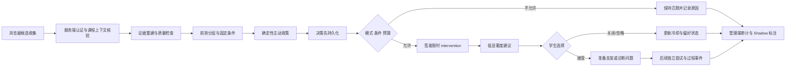

# Calculus Quest V14-C3 主动 Agent 技术报告

> 文档类型：系统设计报告与预注册前研究协议
> 版本：v1.3
> 日期：2026-08-30
> 实验分支：`proactive_test`
> 代码基线：`v2@522e54c`
> 课程对象：Calculus Quest 网站完整章 `V14-C3`“积分直觉与积分方法”
> 研究状态：首个工程垂直切片已实现并通过回归测试；Shadow pilot、正式随机试验和学习效果数据尚未开展

## 摘要

主动教学 Agent 的核心问题不是“能否先于学生说话”，而是系统能否在正确的学习阶段，依据足够可靠的证据，以最低必要强度提供帮助，并在不确定、不可打断或可能污染测量时保持沉默。本报告提出并实现 Calculus Quest 的完整章主动 Agent 策略。设计空间由四个平面和十六个维度构成：教学契约，状态与决策，介入政策，系统与证据。十六维用于定义、冻结和审计一个完整政策包，不作为首轮十六因子实验。

报告以三项研究为主要方法论支点。Hao 等（2026）关于多 Agent 学习环境的研究表明，不同先验水平学生具有不同的互动序列和调节方式，因此系统必须按先验知识分析过程机制与表现差距。Bastani 等（2025）的随机现场实验显示，无护栏的生成式 AI 可以显著提高练习期表现，却损害撤除 AI 后的独立测验表现，因此本系统把受保护测量窗口、最小充分帮助和无 Agent 迁移测验设为硬约束。Chen 等（2025）把帮助寻求拆分为任务定义、信息寻求和信息评价，并通过过程挖掘揭示 ChatGPT 与人类专家支持下的不同路径，因此本研究不把一次点击或对话次数等同于有效帮助，而是记录从证据、建议、学生选择到后续独立尝试的完整序列。

当前实现直接继承 v2 的 `V14-C3` 课程路由和题目，只在学生端投影完整一章。服务端实现 `off`、`shadow`、`active` 三种模式，Control/Treatment 学生级分组，HelpNeed、可打断性与不确定性三项阈值，预算、冷却、受保护测验门控，决策、干预与政策状态持久化，以及管理端审计 Harness。五类可复核候选包括连续无进展调参、带确认缺口的安静停留、错题复盘、知识点形成性结果和支架后独立尝试结果。新增的纵向闭环以形成性错误启动 L1 自我解释，要求学生接受并实际回复，再通过双通道取得支架后的独立结果：当前由平台签发服务端评分的无提示近端验证题，未来也可接收 OpenMAIC 课件的标准语义结果事件。持续失败只升级一级到知识点专属 L2 概念线索，独立成功则渐退并退出本次帮助；学生跳过验证时本轮直接结束且不升级。若升级条件成立但 L2 因预算、模式或执行门控没有实际交付，生命周期会进入 `closed`，避免停留在没有验证题的僵死状态。系统还提供“标准 / 少提醒 / 关闭”三档学生偏好，将决策绑定到学习代次，并保存决策前状态、本次转移和决策后状态。系统保存“政策本来是否想介入”和“是否实际展示”两个不同结果，使 Shadow 与 Control 条件仍可产生反事实政策记录。

本报告建议先开展整章 Shadow pilot，以双人编码校准 HelpNeed 和可打断性，再开展学生级两组随机可行性试点。首要学习指标是撤除 Agent 后的章后近迁移，而非提示接受率或 Agent 在场时的即时正确率。当前没有真实参与者结果，不能据此声称政策改善了学习、保持或表现差距。

**关键词：** 主动教学 Agent；HelpNeed；可打断性；生成式 AI 护栏；多 Agent 学习；帮助寻求；学习迁移；因果实验

## Abstract

Proactive educational agents should be evaluated by more than their ability to initiate interaction. A defensible system must intervene at an appropriate learning stage, rely on sufficiently strong evidence, deliver the minimum necessary support, preserve learner control, and abstain when uncertainty, interruption cost, or assessment contamination is high. This report presents a full-chapter proactive-agent policy for the Calculus Quest chapter V14-C3. The design space comprises four planes and sixteen dimensions covering the instructional contract, state and decision, intervention policy, and system governance and evidence.

Three studies provide the main methodological anchors. Hao et al. (2026) motivate prior-knowledge-stratified analyses of interaction sequences and performance gaps in multi-agent environments. Bastani et al. (2025) demonstrate why assisted task performance must be separated from learning measured after AI support is removed. Chen et al. (2025) motivate a process view of help seeking that distinguishes task definition, information seeking, evaluation, and subsequent action. These principles are operationalized as protected assessment windows, separate HelpNeed and interruptibility gates, uncertainty-aware abstention, minimum-support actions, student confirmation, event-sequence logging, and no-agent transfer and retention measures.

The current implementation inherits the complete V14-C3 chapter and item bank from the v2 route, while projecting only that chapter to students. A deterministic server-side policy supports off, shadow, and active modes; student-level Control and Treatment assignments; thresholds for HelpNeed, interruptibility, and uncertainty; budget and cooldown controls; protected-assessment enforcement; persistent decision and intervention ledgers; and an administrative audit harness. A knowledge-point support episode now links a confirmed formative error to L1 self-explanation, an actual learner response, and a subsequent independent result obtained through either a server-scored, no-hint proximal probe or a future standardized courseware semantic event. Persistent friction permits one-level escalation to an L2 concept hint; success fades and exits the episode, while declining the probe exits without escalation. Undelivered escalation closes the episode safely. Three learner-controlled prompting levels, learning-generation isolation, and before-transition-after state snapshots make the policy inspectable across resets without mixing support episodes. The report proposes a shadow pilot followed by a two-arm randomized feasibility study. No participant outcome data have yet been collected, so effectiveness claims are outside the present evidence boundary.

**Keywords:** proactive educational agent; HelpNeed; interruptibility; generative AI guardrails; multi-agent learning; help seeking; learning transfer; causal experiment

# 一、执行结论

## 1.1 十六维不适合作为首轮十六因子实验

四平面十六维是主动 Agent 的设计本体和治理清单。它回答以下问题：

- 系统在优化什么学习目标；
- 哪些证据可以支持何种状态判断；
- 何时应介入，何时应保持沉默；
- 可以采取哪些教学动作和支架强度；
- 学生、教师、Agent 与研究者分别拥有什么权限；
- 决策如何版本化、持久化、审计和评价。

若把十六维直接转成十六个实验因素，首轮研究将产生无法承担的样本需求、交互项和解释负担。因此，首轮只操纵一个组间因素：

```text
固定版主动政策包关闭
vs.
固定版主动政策包开启
```

十六维在首轮中的作用是冻结处理内容，防止研究期间因局部指标波动而随意改变政策。后续只有在整包安全、可行且具有足够事件量后，才拆分 HelpNeed 阈值、介入时机、支架强度或呈现方式等单一机制。

## 1.2 不能主张“此前没有主动教学 Agent 研究”

现有研究已经分别覆盖主动或响应式 Agent、HelpNeed 预测、注意状态介入、生成式 AI 护栏、多 Agent 课堂、帮助寻求过程分析、学习者自主权、迁移评价和微随机试验。基于项目既有的 96 篇全文证据集及截至 2026-08-30 的针对性反例检索，本报告尚未识别出一篇同时完成以下组合的研究：

1. 在网站完整一章中持续运行，而不是只处理单题或单活动；
2. 把四平面十六维冻结为版本化政策包；
3. 联合判断 HelpNeed、可打断性和不确定性；
4. 同时记录介入与保持沉默的原因；
5. 实现预算、冷却、重复、升级、渐退和退出；
6. 由服务端执行条件、权限和受保护测量门控；
7. 保留学生对帮助、回复和学习路径的最终确认；
8. 使用学生级条件分配；
9. 在撤除 Agent 后测量近迁移、跨表征迁移和延迟保持。

这是一项有边界的检索结论，不是对全球文献“绝对不存在”的证明。合理的新颖性主张是：

> 本研究把分散在 AIEd、HCI、学习科学、JITAI 和 Agent 治理中的部件，整合为一个整章运行、版本化、可审计、双门控、保留学生关闭权并以撤除后迁移评价为目标的主动政策包。

## 1.3 当前交付不是学习效果论文

本轮已经完成设计、首个工程切片和测试，不包括真实学生的 Shadow 标注或随机试验结果。因此，以下表述目前均不成立：

- 主动策略提高了微积分成绩；
- 主动策略改善了 7 天保持；
- 主动策略缩小了高低基础学生差距；
- HelpNeed 分数已经完成经验校准；
- 当前阈值优于其他阈值；
- 学生接受率证明了教学有效性。

本报告的证据等级是“系统已实现并验证，实验协议可执行，效果尚待检验”。

# 二、研究问题与贡献边界

## 2.1 研究对象

研究对象是 Calculus Quest 网站中的完整章 `V14-C3`，不是 OpenMAIC 的单个课件包。课程事实由 `data/multi-scene-learning-route.json` 唯一维护：

| 项目 | V14-C3 当前事实 |
|---|---|
| 章标题 | 积分直觉与积分方法 |
| 模块 | `GH-06`、`GH-07` |
| 知识点 | 7 个 |
| 每知识点互动候选 | 4 个 |
| 互动候选总数 | 28 个 |
| 章前测 | 10 题 |
| 知识点形成测验 | 7 组，每组最多 2 题 |
| 章后测 | 10 题 |
| 预计学习时长 | 约 80 至 110 分钟 |
| 路径原则 | Agent 提议，学生确认 |

七个知识点覆盖小矩形逼近、定积分累积、原函数与不定积分、变上限积分、牛顿-莱布尼茨公式、换元法直觉和分部积分直觉。

## 2.2 研究问题

**RQ1 可行性：** 固定版主动政策能否在完整章流程中稳定执行，并把不相关、不可打断或不可审计的提示控制在预注册范围内？

**RQ2 学习：** 相对于保留 reactive assistant 但关闭时刻级主动政策的 Control，Treatment 是否改善撤除 Agent 后的章后近迁移和延迟保持？

**RQ3 机制：** 学习差异是否与更早暴露误解、有效表征切换、自我解释和错题复盘有关，而不是只与对话或提示数量有关？

**RQ4 自主权与差距：** 政策是否维持学生感知控制，并避免对低前测学生造成更高的打断和依赖负担？

**RQ5 泛化：** 通用政策内核能否在不修改核心决策代码的条件下，通过新增学科 adapter 迁移到其他章节或学科？

## 2.3 候选贡献

本研究的贡献候选分为四类：

1. **设计贡献：** 将主动教学 Agent 压缩为四平面十六维，同时区分设计本体与实验因素。
2. **系统贡献：** 实现“候选收集、服务端证据重建、确定性政策、条件门控、知识点支架回合、可替换独立证据通道、学生确认与关闭、结果审计”的完整闭环。
3. **方法贡献：** 把反事实政策决定与实际展示分开记录，同时保存学习代次和“决策前状态—本次转移—决策后状态”，使 Shadow、Control、重置后历史和未交付升级都可复演。
4. **评价贡献：** 把撤除 Agent 后的迁移与保持置于即时表现、接受率和对话量之前。

在工程上，本项目相对于上述论文依据的延伸不是再增加一种弹窗，而是实现“知识点级支架回合”：

```text
形成性错误
-> L1 自我解释
-> 学生实际回复
-> 平台无提示近端验证题
   或课件标准语义结果事件
-> 持续失败时 L2 概念线索
-> 第二次无提示验证或课件结果
-> 成功后退出本次帮助
```

这一回合由通用政策内核负责状态、权限、预算和审计，由 V14-C3 adapter 负责七个知识点的自我解释问题、L2 概念线索及 L1/L2 各一道无提示验证题。当前 28 个 OpenMAIC 场景经全量静态检索，没有发送 `courseware_challenge_result`、`courseware_formative_check_submitted` 或 `maic_learning_event`，因此不能把“未来事件契约”误写成当前已运行证据。平台先用 `policy_owned_probe` 完成真实闭环，同时保留 `courseware_semantic_event` 通道，未来只要 OpenMAIC 在生成期输出标准事件即可替换或补充 probe，而无需修改政策内核。这种“通用生命周期 + 章节 adapter + 可替换证据通道 + 学习代次隔离 + 状态转移 Harness”的组合，是 Calculus Quest 当前最值得迁移到第二章验证的系统创新。probe 只衡量本轮支架后的近端恢复，不构成稳定掌握、迁移或保持的证据。

# 三、三篇核心论文的方法论映射

## 3.1 Mapping：从互动总量转向互动动力学

Hao 等（2026）在 MAIC 多 Agent 学习环境中分析了大学生与 AI 教师、AI 同伴等角色的对话。研究报告了 305 名初始参与者、131 名完整课程完成者和 19,365 条互动记录，并使用行为编码、转移分析和滞后序列分析识别“知识共同建构”和“学习共同调节”两类模式。高先验知识学生更频繁地主动管理学习进程与 Agent 角色，低先验知识学生更常提问、协商和确认；不同先验组的学习增益与动机变化也不同。

该研究对 Calculus Quest 有四项直接约束：

1. 不能只比较两组的提示总量或对话总量，必须分析事件转移序列。
2. 必须在随机化和结果分析中显式处理前测水平。
3. Agent 角色需要有清晰职责，不能让一个模型同时判断状态、选择动作、生成内容和改写路径。
4. 表现差距分析要同时报告收益和负担，例如低基础学生是否获得更多有效支持，也是否承受更多打断。

Hao 等的研究是观察性过程分析，且主要后测为即时测量，不能据此推断多 Agent 互动本身造成了学习提升。本研究因此保留其过程分析方法，但用随机条件、无 Agent 迁移和延迟保持补足因果与持久学习证据。

## 3.2 Guardrails：从“做得更好”转向“学得更好”

Bastani 等（2025）在土耳其高中数学课堂开展了随机现场实验。研究区分练习阶段和关闭技术的独立考试阶段。GPT Base 与带教学护栏的 GPT Tutor 均显著提高练习期表现，但 GPT Base 组在撤除 AI 后的考试中显著低于对照组，GPT Tutor 则没有出现同等程度的负面效应。对话分析还显示，GPT Base 更容易被学生当作直接答案工具，而 GPT Tutor 通过提示词和教学约束降低了这种“拐杖式”使用。

该研究构成本系统最重要的结果评价约束：

- Agent 在场时的正确率不是学习效果；
- 形成测验与后测必须有服务端受保护窗口；
- 首轮从 L0/L1 最小充分帮助开始；
- Agent 不得自动替学生完成方法选择、关键推理和答案输入；
- 迁移与保持必须在没有主动建议、reactive assistant、答案反馈和 Path Coach 的条件下完成；
- 对话内容要检查直接索取答案、复制和依赖模式，而不只计算轮数。

本研究不会复刻 GPT Base、GPT Tutor、Control 三臂设计。首轮只比较同一基础平台上的主动政策关闭与开启，以控制样本和工程复杂度。若后续需要检验语言护栏本身，再独立比较不同 renderer，而不与“是否主动介入”混在同一首轮实验中。

## 3.3 Unpacking：从一次帮助请求转向帮助寻求过程

Chen 等（2025）比较了 14 名大学生在 ChatGPT 与人类专家支持下完成学习分析任务的帮助寻求过程。研究把过程分为任务定义、信息寻求和信息评价，并结合屏幕记录、眼动、访谈、情绪表达与过程挖掘。ChatGPT 条件呈现更频繁、碎片化和循环的路径，人类专家条件更线性，并在任务定义与评价阶段提供更多结构。研究同时指出，小样本、任务难度差异和界面差异限制了结果的泛化。

Calculus Quest 不复制摄像头、麦克风或眼动采集，而是采用更小化的数据方案，将其过程观点映射为：

```text
任务定向
-> 产生可观察证据
-> 判断是否需要帮助
-> 等待可打断边界
-> 展示或保持沉默
-> 学生接受、拒绝或忽略
-> 学生独立尝试
-> 进展、重复错误或退出
```

因此，`shown`、`accepted` 和对话轮数都只是过程状态。有效帮助至少还需要观察学生是否重新尝试、是否恢复进展、错误是否复现，以及随后无 Agent 题目是否迁移。

## 3.4 三篇论文与本研究的互补关系

| 方法问题 | Mapping | Guardrails | Unpacking | Calculus Quest 采用方式 |
|---|---|---|---|---|
| 多 Agent 角色 | 直接研究 | 非核心 | 单一 AI/人类专家比较 | 模块化角色与权限分离 |
| 先验知识差异 | 核心分析 | 含异质性分析 | 小样本背景变量 | 前测分层、交互项与差距指标 |
| 即时表现 | 有前后测 | 明确与学习分离 | 任务完成过程 | 只作为过程指标 |
| 独立学习 | 即时后测为主 | 关闭技术考试 | 无延迟迁移 | 无 Agent 迁移与 7 天保持 |
| 帮助寻求序列 | 滞后序列分析 | 对话策略分类 | 过程挖掘 | 事件状态机与转移分析 |
| 学生自主权 | 可管理角色和进度 | 可选择是否使用 AI | 主动向来源求助 | 接受、拒绝、忽略、降频、关闭 |
| 主要风险 | 选择偏差与即时测量 | 依赖与直接答案 | 碎片化、负面体验 | 误报、打断、依赖、泄题 |
| 因果识别 | 主要为观察性 | 随机现场实验 | 小样本组间比较 | 先 Shadow，再学生级随机 |

## 3.5 辅助架构与时刻级实验框架

Yu 等（2026）的 MAIC 架构说明，多 Agent 可以分别承担教师、助教、同伴、分析和课堂管理等职责。本研究继承其模块化思想，但把“谁在何时出现”从自由生成式编排中进一步拆出，交给版本化、确定性的服务端政策。语言模型只在政策决定之后承担有限表达任务。

主动介入同时具有典型的时刻级决策结构：可用信息随时间变化，系统在多个 decision point 上选择介入或沉默，并观察近端结果。JITAI 的可用性、介入选项和 decision rule 概念用于定义本设计空间；微随机试验可在固定政策完成安全验证后用于优化单个机制，而不是替代首轮整包随机试点（Klasnja et al., 2015; Nahum-Shani et al., 2018）。

# 四、四平面十六维设计空间

## 4.1 平面一：教学契约

### D1 学习目标

优化优先级固定为：

```text
独立迁移与保持
> 概念理解
> 有效帮助寻求
> 当场任务完成
> 提示数量、接受率和对话量
```

V14-C3 的目标是建立面积、累积、原函数和积分方法之间的概念连接，并能在新函数、新表征和新情境中选择方法。

### D2 学习者与任务阶段

政策区分章前准备、前测、讲解、互动探索、形成测验、错因复盘、场景选择、后测、迁移和保持。前测、测验作答、后测、迁移和保持均为受保护窗口，服务端一律返回 `stay_silent`。

### D3 Agent 角色与权限

| 角色 | 主要职责 | 权限边界 |
|---|---|---|
| Evidence Agent | 聚合测验、互动和时间证据 | 不直接选教学动作 |
| State Estimator | 估计 HelpNeed、可打断性和不确定性 | 不把停留直接命名为困惑 |
| Policy Agent | 在白名单内决定沉默、动作和强度 | 不创造课程事实 |
| Pedagogy Adapter | 提供知识点误解、场景语义和合法支架 | 不修改 route 或题目 |
| Language Renderer | 把已选动作表达为学生可读文本 | 不改变动作和答案边界 |
| Path Coach | 提出回看、重学和拓展建议 | 不自动改变路径 |
| Research Governor | 固定分组、版本和停止规则 | 不按中期结果重写历史 |

### D4 学习科学护栏

护栏包括先预测再反馈、最小充分帮助、不替代核心认知活动、答案保护、表征桥接、自我解释、渐退与退出，以及学生可反驳 Agent 状态判断。首轮实时 LLM 不参与触发、动作选择或强度决策。

## 4.2 平面二：状态与决策

### D5 可观察证据

证据分为结果、任务、过程、时间、自报和历史六族。首轮代码使用：

- `result`：服务端确认的错题或知识缺口；
- `task`：互动任务边界与是否恢复进展；
- `process`：参数提交与重复操作；
- `time`：有效停留及其时序。

单一鼠标移动、后台停留或单次点击不能独立触发。

### D6 潜在学习状态

完整设计定义掌握、误解、摩擦、进展、帮助倾向和表征需要。首轮实现没有训练潜变量模型，而是使用可审计的确定性分数和政策状态。报告必须把这些分数称为“政策评分”，不能写成已校准的心理诊断概率。

### D7 不确定性与误报成本

决策概念模型为：

```text
期望价值
= P(需要帮助) × 预期学习收益
- P(误报) × 打断成本
- 自主权成本
- 依赖成本
```

首轮阈值为：

```text
helpNeedScore >= 0.70
interruptibilityScore >= 0.75
uncertaintyScore <= 0.30
```

高不确定、证据不足、预算耗尽、处于冷却或学生关闭时均保持沉默。

### D8 HelpNeed 与可打断性

系统把两个问题分开：

1. 学生是否可能需要帮助；
2. 当前时刻是否适合出现。

安静停留即使伴随已确认缺口，也先保存短期候选。只有随后出现 `interactive_submit` 等自然任务边界，且候选仍有效，才重新评估。系统不得把排队候选在任意未来时刻无条件弹出。

## 4.3 平面三：介入政策

### D9 教学动作

完整设计包含沉默、确认、注意聚焦、预测、自我解释、表征对比、概念提示、子目标提示、误解复盘、场景推荐、休息建议和人工转介。当前代码接线五类候选和五个动作，其中形成性结果与独立尝试共同构成纵向支架回合：

| 候选 | 动作 | 强度 | 呈现 |
|---|---|---|---|
| 连续无进展调参 | `observe_change` | L1 | `inline_nudge` |
| 带确认缺口的安静停留 | `ask_clarification` | L0 | `inline_nudge` |
| 形成测验错题复盘 | `review_mistake` | L1 | `assistant_prompt` |
| 知识点形成性错误 | `elicit_self_explanation` | L1 | `assistant_prompt`，学生自由回复 |
| L1 后独立尝试仍失败 | `concept_hint` | L2 | `assistant_prompt`，知识点专属概念线索 |

### D10 支架强度

L0 只确认状态和提供选择，L1 提供观察点、自检或自我解释，L2 提供概念与表征线索，L3 提供部分示例。当前已实现 L0/L1 和七知识点专属 L2，并只允许从 L1 升一级到 L2。L3 仍未接线；L2 后继续失败时进入 `maximum_support_reached`，不自动给出部分例题或答案。

### D11 呈现方式

默认建议条不自动打开聊天、不自动播放、不遮挡主任务。学生接受后，系统可以准备一个诊断问题或草稿，但不会自动发送。需要回复时，学生可以选择一个回答起点，也可以自由输入。

### D12 学生自主权

学生决定是否展开帮助、是否发送回复、是否切换场景、是否回看或重学。Control 和 Treatment 均保留主动提问入口。知点侧栏已经提供“标准 / 少提醒 / 关闭”三档：`reduced` 屏蔽安静停留和连续调参等行为型候选，但保留形成性错误等强结果证据；`off` 结束当前未完成主动回合并停止后续候选收集，但不禁用学生主动提问。正式实验仍需在同意材料中解释三档含义、日志边界与 ITT 处理。

### D13 重复、升级、渐退与退出

当前实现包含：

- 同一知识点已有未决 offer 时不重复签发；
- 接受后冷却 10 分钟；
- 第一次负向反馈冷却 10 分钟；
- 第二次负向反馈冷却 20 分钟；
- 两次连续负向反馈后，非错题复盘候选被拒绝；
- 场景、单元、账号或可见性变化时将旧建议记为忽略；
- 过期、跨用户、越序和重放的 resolution 被拒绝；
- 形成性错误只开启 L1，不允许重复使用同一份一次性测验结果升级；
- 学生接受并实际回复后，生命周期才进入 `awaiting_independent_attempt`；
- 只有平台自有无提示验证或课件语义结果经服务端校验后，才可以触发升级或退出；
- L1 后独立失败升级到知识点专属 L2，拒绝、未回复或无证据时保持静默；
- 学生可以跳过无提示验证；跳过后本轮结束且绝不升级；
- 一次独立成功将当前帮助回合恢复到 L0、增加一次 fade 并退出；
- L2 后仍失败则停止自动升级；
- L1 后独立失败已经确认，但 L2 因预算、已有提示、模式或 renderer 门控未实际交付时，进入 `closed` 并记录未交付原因；
- 学习重置时清除旧知识点生命周期，保留 assignment 与学生偏好；新旧决策用 `learning_generation` 隔离。

当前“退出”只表示不再继续本次帮助，不能解释为知识点已经掌握。跨帮助回合的长期渐退、L3、自动第三次负向反馈关闭和人工转介尚未接线。

### D14 个性化记忆

当前持久化 assignment、知识点级拒绝次数、冷却、当前强度、渐退字段、偏好字段、最后原因、待自然边界候选，以及支架回合的 phase、活动动作、回复时间、独立尝试数、成功与持续卡点证据数。每条 decision 还固化学习代次；学习重置只清除旧生命周期，不改写历史决策，也不改变学生已经固定的实验条件。首轮不根据受保护人口属性、人格推断、情绪诊断或完整自由文本进行个性化。

## 4.4 平面四：系统与证据

### D15 模块化后端与治理

通用政策内核接收章节、单元、场景、候选、证据、状态、预算与当前时间，返回版本化决策。核心输出同时包含：

```js
{
  decision: "stay_silent" | "intervene",
  deliveryDecision: "stay_silent" | "intervene",
  learningGeneration,
  action,
  supportLevel,
  helpNeedScore,
  interruptibilityScore,
  uncertaintyScore,
  reasonCodes,
  policyStateBefore,
  stateTransition,
  policyStateAfter,
  expiresAt
}
```

`decision` 表示固定政策在当前证据下的判断，`deliveryDecision` 表示考虑模式、实验条件和预算后的实际呈现决定。这一分离是 Shadow 回放和 Control 反事实审计的基础。`policyStateBefore`、`stateTransition` 与 `policyStateAfter` 使研究者能够区分“观察到什么状态”“政策尝试如何更新状态”和“最终落盘为什么状态”，而不是只看到一个动作标签。

### D16 学习效果评价与因果实验

评价分为三层：

1. **安全性：** 受保护窗口违例、跨用户、重放、泄题和内容错误；
2. **可行性：** 决策持久化、延迟、误报、展示、接受、关闭和打断；
3. **学习性：** 无 Agent 近迁移、跨表征迁移、方法选择和 7 天保持。

安全和可行性门槛不能被学习均值抵消。即使学习分数较高，只要出现泄题或跨用户干预，也应暂停 active。

# 五、系统架构与决策链

## 5.1 总体架构



浏览器只负责识别候选并发送上下文。服务端重新读取事件、测验和课程状态，客户端不能指定 condition、action 或 support level。

## 5.2 分组与模式

| 模式/条件 | 政策计算 | 实际展示 | 主要用途 |
|---|---|---|---|
| `off` | 直接沉默 | 否 | 关闭政策 |
| `shadow` | 是 | 否 | 收集反事实候选与误报 |
| `active + control` | 是 | 否 | 随机试验对照 |
| `active + treatment` | 是 | 符合门控时展示 | 随机试验处理 |

前测完整提交前不创建 assignment。当前代码使用 9 道服务端即时评分客观题的 80 分部分计算分层，`>= 0.60` 为 `pre-high`，其余为 `pre-low`。简答题不参与分层，避免异步 LLM 评分时机改变条件。

当前 assignment 使用学生 id、实验 id、分层、版本和私有 salt 的 SHA-256 哈希，保证同一学生跨设备和重启保持稳定。该方法适合工程 pilot 和重放，但不能保证小样本严格 1:1。正式试验应在首位参与者进入前改用分层置换区组或预注册可接受失衡范围。

## 5.3 五类候选与纵向决策点

### 连续无进展调参

必须由服务端确认至少三次参数提交，且第一次提交后没有任务进展。需要 `process` 与 `task` 两族证据，默认输出 `observe_change`、L1。

### 安静停留

纯时间证据的 HelpNeed 最高为 0.45，低于阈值。只有存在服务端确认的知识缺口，并同时有 `time` 和 `result` 证据时，候选才可进入等待状态。实际显示还必须等待自然任务边界。

### 错题复盘

必须有已提交且确认错误的形成测验记录，并等待评分完成。前测、后测、迁移和保持即使已经提交，也持续属于受保护测量，不开放答后主动教学。

### 知识点形成性结果

知识点的一次性形成测验出现已确认错误且没有待复核评分时，政策可以签发 `elicit_self_explanation`、L1。它要求学生用自己的话解释关键关系，不提供完整解析。形成测验结果只负责开启支架回合；学生接受后必须实际回复，系统才进入等待独立尝试状态。重复请求同一份形成测验结果只能得到 `independent_attempt_required` 或其他静默原因，不能升级。

### 支架后独立尝试

当前采用可替换的双通道证据接口：

1. **平台通道 `policy_owned_probe`：** 学生完成 L1 或 L2 回复后，服务端按知识点和当前强度签发一道无提示选择题。V14-C3 共 14 道，七个知识点各有 L1、L2 两道。答案键只存在于服务端 adapter，学生状态只获得题目 ID、题干和选项。服务端校验知识点、生命周期、题目 ID、当前强度和答案；同一题重放被拒绝。学生可选择“暂不检查”，此时进入 `declined` 并停止升级。
2. **课件通道 `courseware_semantic_event`：** 若未来 OpenMAIC 场景在学生回复后发送 `courseware_challenge_result` 或 `courseware_formative_check_submitted`，服务端从已落盘事件重建结果、时间和引用，并送入同一生命周期。目前 V14-C3 的 28 个场景不发送这些事件，因此该通道已通过合成 API 回归，但不是当前真实课件的默认来源。

两条通道最终都生成相同的 `independent_attempt_outcome`，交给同一个确定性政策判断。L1 后失败时签发知识点专属 `concept_hint`、L2；L2 后失败时进入 `maximum_support_reached`；成功时退出当前帮助回合。平台 probe 是支架回合的近端过程测量，不能替代无 Agent 迁移与保持。

## 5.4 数据模型

| 表 | 关键内容 | 研究用途 |
|---|---|---|
| `experiment_assignments` | 条件、cohort、stratum、assignment version | 固定分组与 ITT |
| `proactive_decisions` | 学习代次、证据快照、三项分数、原因码、政策与交付决定、状态前后快照 | Shadow、审计、反事实与跨代隔离 |
| `proactive_interventions` | offered、shown、accepted、dismissed、ignored、expired | 曝光与学生响应 |
| `proactive_policy_state` | 冷却、拒绝次数、偏好、待边界候选、当前强度、`lifecycle_json` | 支架回合、渐退、退出和个性化记忆 |

每条 decision 保存 policy、contract、adapter、assignment version、`scope_key`、`learning_generation`、决策前状态、本次状态转移与决策后状态。intervention 的 `followup_outcome_json` 分开保存学生实际回复与随后独立任务结果。管理端只把同一学生、同一知识点、同一实验、同一学习代次的多条 decision 组织成 L1→L2→退出策略链，并以中文并列展示“决策前 / 本次转移 / 决策后”，同时保留原始 JSON。历史代次不挂接新代次的当前政策状态；模型或阈值升级也不能覆盖历史记录。

## 5.5 API 与权限

| 接口 | 功能 |
|---|---|
| `GET /api/learning/proactive/state` | 返回不暴露真实条件的学生状态收据 |
| `POST /api/learning/assistant/intervention` | 提交候选，由服务端重建证据并决策 |
| `POST /api/learning/proactive/check` | 提交或跳过平台无提示验证；答案仅在服务端评分 |
| `POST /api/learning/proactive/:decisionId/resolution` | 提交 shown、accepted、dismissed 或 ignored |
| `GET /api/admin/research/proactive-decisions` | 管理端筛选、汇总与导出审计账本 |

学生端只有在服务器返回有效 `decisionId`、`interventionId`、`active` 模式和 `deliveryDecision=intervene` 时才展示建议。网络或状态不可用时，V14-C3 失败关闭，不启用历史本地展示 fallback。

# 六、当前实现与验证证据

## 6.1 已实现

| 能力 | 状态 | 证据位置 |
|---|---|---|
| v2 完整章继承 | 已实现 | `lib/proactive-policy/index.js` 的 route 投影与对应测试 |
| 前测完成后固定分组 | 已实现 | `server.js`、`experiment_assignments` |
| `off/shadow/active` | 已实现 | `lib/proactive-policy/index.js` |
| Control/Treatment 双决定 | 已实现 | `decision` 与 `delivery_decision` |
| HelpNeed/可打断性/不确定性阈值 | 已实现 | `evaluate()` |
| 受保护测量窗口 | 已实现 | `protectedAssessmentStage()` |
| 五类候选与 L0/L1/L2 动作 | 已实现 | `adapters/v14-c3.js`、`lifecycle.js` |
| 知识点纵向支架回合 | 已实现 | 形成性错误→L1→学生回复→独立结果→L2 或退出 |
| 平台无提示验证 | 已实现 | 七知识点共 14 道；答案服务端持有；支持跳过、重放阻断和重启恢复 |
| 双通道独立证据 | 已实现 | `policy_owned_probe` 当前运行；`courseware_semantic_event` 通过合成 API 回归 |
| 独立证据与拒绝保护 | 已实现 | 旧形成测验不能重用；未回复、拒绝、跳过或无证据时不升级 |
| 服务重启后恢复生命周期 | 已实现 | `proactive_policy_state.lifecycle_json` 与 API 回归 |
| 决策、干预、状态持久化 | 已实现 | `db.js` 四张表 |
| 三档学生偏好 | 已实现 | “标准 / 少提醒 / 关闭”；服务端持久化并约束候选 |
| 学习代次隔离 | 已实现 | decision 固化 `learning_generation`；重置清理旧生命周期；Harness 不跨代串链 |
| 决策状态前后审计 | 已实现 | `policyStateBefore`、`stateTransition`、`policyStateAfter` 与中文状态转移视图 |
| 未交付升级安全收束 | 已实现 | L2 未实际签发时进入 `closed`，保留独立失败与未交付原因 |
| 学生确认与不自动发送 | 已实现 | `app/main/knowledge-assistant.js` |
| 跨用户、越序、重放、过期保护 | 已实现 | resolution API 与 API 测试 |
| Harness、筛选、汇总、策略链与 CSV | 已实现 | `admin.html`、`admin/admin.js` |

## 6.2 已设计但尚未完整实现

| 能力 | 当前缺口 |
|---|---|
| L3 支架与人工转介 | L2 后持续失败会停止升级；尚未提供部分例题或人工转介 |
| 跨帮助回合的长期渐退 | 当前一次独立成功只退出本次帮助；两次以上成功如何影响未来支架尚未进入政策 |
| 28 个场景的语义结果事件 | 当前两包静态检索为 0；需未来 OpenMAIC 生成期按统一契约输出，或继续使用平台 probe |
| 独立近迁移与跨表征题 | 尚未接入学生流程 |
| 7 天保持 | 尚未接入提醒、测验和缺失处理 |
| 自动负向反馈降频 | 当前有冷却与两次负向反馈保护，但“第三次自动关闭本章主动提示”尚未接线；学生可随时手动选择关闭 |
| 教师覆盖与内容复核 | 尚无运行时人工转介和教师覆盖控件；L1/L2 静态内容仍需正式试验前完成学科复核 |
| 普通事件可信来源 | 服务端会重建与校验，但仍不是密码学签名事件 |
| 第二章迁移 | 尚未用 adapter-only 方式实作 |

## 6.3 已通过验证

截至 2026-08-30，相关实现已通过：

- `proactive:test`
- `assistant:test`
- `admin:test`
- `durability:test`
- `security:test`
- `auth:test`
- `quiz:test`
- `path:test`
- `flow:test`
- `browser:smoke:test`

浏览器已完成桌面和 390×844 移动端验收，包括单章导航、10 题前测、刷新恢复、主动建议、跨账号隔离、管理账本和 CSV 入口。当前测试证明的是代码行为，不是学习效果。

# 七、V14-C3 Shadow pilot

## 7.1 目的

Shadow 阶段不向学生显示新政策建议。它用于估计：

- 候选是否真的代表帮助需要；
- 当前时刻是否适合打断；
- 服务器证据与界面回放是否一致；
- 不同知识点和场景的误报是否集中；
- 受保护窗口是否始终为零展示；
- 当前阈值是否需要在正式试验前冻结或调整。

## 7.2 最小数据要求

建议至少收集 100 个可复核候选窗口，并尽量覆盖：

- 7 个知识点；
- simulation、game、mindMap、visualization3d 四种场景；
- 五类候选，并单独覆盖形成性触发、等待回复、独立失败、L2 升级和成功退出；
- 高低前测层；
- HelpNeed 高但不可打断、可打断但 HelpNeed 低、两者均高等组合。

100 个窗口是工程校准下限，不是学习效果样本量。

## 7.3 双人编码协议

两名复核者独立查看去标识的事件时间线、课程位置、必要界面回放和政策证据，不查看学生条件。每个窗口编码：

```text
help_needed: yes / no / uncertain
interruptible: yes / no / uncertain
best_action: silent / L0 / L1 / L2 / L3
content_risk: none / answer_leak / mathematical_error / autonomy_risk
```

先报告原始一致率和 Cohen's kappa。若类别高度不平衡，同时报告适合低流行率情境的补充一致性指标，并保留分歧类别，不用模型生成的标签替代人工真值。

## 7.4 进入 active 的门槛

必须同时满足：

1. 受保护窗口实际展示数为 0；
2. 决策与 intervention 持久化成功率不低于 99%；
3. 跨用户、伪造、重放和越序测试全部通过；
4. 明显误报率低于预注册阈值；
5. 每个知识点至少有人工复核候选；
6. 教师确认没有数学错误和答案泄露；
7. assignment salt、实验 id、政策、契约和 adapter 版本已经冻结。

# 八、学生级随机可行性试点

## 8.1 条件

| 条件 | 学生体验 |
|---|---|
| Control | reactive assistant、场景选择和 Agentic 路径保留；关闭历史与新时刻级主动建议 |
| Treatment | 在相同基础上，只增加固定版服务端主动政策包 |

两组均可主动提问。Treatment 学生可以关闭主动提示，但仍按原分组进入 ITT 分析。

## 8.2 流程

```text
同意与基线
-> 无主动前测
-> GH-06 学习
-> 形成测验作答期间无主动支持
-> 成绩快照后允许学习性复盘
-> GH-07 学习
-> 无 Agent 章后测
-> 无 Agent 近迁移与跨表征迁移
-> 体验量表与访谈
-> 7 天无 Agent 保持测验
```

从进入章后测到完成迁移题，冻结 reactive assistant、主动建议、答案反馈和 Path Coach。迁移完成后才显示反馈与章级路径建议。

## 8.3 随机化

- 单位：学生；
- 分层：`pre-high` 与 `pre-low`；
- 时点：完整提交 10 题前测后，进入首个学习场景前；
- 隐蔽：学生状态接口不返回真实 condition；
- 持久：同一学生跨设备、刷新和重启保持原分组；
- 主分析：ITT。

正式试验推荐使用中心化分层置换区组。若保留哈希分配，必须预注册 salt 固定时点、算法版本、可接受失衡范围和协变量调整方式。

## 8.4 样本定位

| 完成样本 | 可以回答的问题 |
|---|---|
| 少于 40 | 技术、流程和严重风险 |
| 60 至 100 | 随机可行性、方差、流失和探索性效应量 |
| 正式效能样本 | 根据 pilot 方差、前后测相关、聚类和缺失率重新计算 |

小样本没有显著差异不能解释为两组等效。正式效能分析应以一个确认性学习终点为中心，避免把大量次要指标同时当作主要结果。

# 九、测量设计

## 9.1 确认性学习终点

建议把“章后无 Agent 近迁移复合分数”设为唯一确认性学习终点。题目不得复用学习阶段的表面形式、数值和选项顺序，且应覆盖解释、判断和方法选择。

## 9.2 安全与可行性门槛

这些指标独立于学习终点：

- 受保护窗口违例数，目标为 0；
- 明显误报率及 95% 置信区间；
- 决策持久化成功率；
- 候选到决策延迟；
- 跨用户、重放、过期和越序拒绝率；
- 学生被打断感和感知控制；
- 全章关闭、关闭与忽略比例。

## 9.3 次要学习结果

- 跨表征迁移；
- 积分方法选择；
- 概念解释质量；
- 7 天保持；
- 学习时间；
- 错误复现；
- 帮助依赖；
- 高低前测组的结果差距。

开放题应使用事先定义的评分 rubric，并由不知道学生条件的复核者进行双人评分。

## 9.4 过程指标

借鉴 Hao 等（2026）的序列分析与 Chen 等（2025）的帮助寻求分段，建议编码以下事件状态：

| 状态 | 示例事件 |
|---|---|
| `ORIENT` | 进入新知识点或新表征 |
| `EVIDENCE` | 重复调参、确认错题、安静停留 |
| `WAIT_BOUNDARY` | HelpNeed 高但暂不可打断 |
| `SILENT` | 政策因证据、阈值、条件或预算保持沉默 |
| `OFFER` | 建议展示 |
| `ACCEPT/DISMISS/IGNORE` | 学生对建议的选择 |
| `HELP_USE` | 回答诊断问题、修改草稿、主动提问 |
| `INDEPENDENT_ATTEMPT` | 支架后的第一次独立行动 |
| `PROGRESS/REPEAT_ERROR` | 恢复进展或错误复现 |
| `EXIT` | 离开、过期、掌握或关闭 |

需要重点比较的序列包括：

```text
EVIDENCE -> OFFER -> ACCEPT -> INDEPENDENT_ATTEMPT -> PROGRESS
EVIDENCE -> SILENT -> INDEPENDENT_ATTEMPT -> PROGRESS
OFFER -> DISMISS -> PROGRESS
OFFER -> ACCEPT -> HELP_USE -> REPEAT_ERROR
WAIT_BOUNDARY -> OFFER
WAIT_BOUNDARY -> EXIT
```

第一类反映可能有效的主动支架，第二类识别生产性挣扎，第三类避免把拒绝自动解释为失败，第四类提示支架无效或依赖风险。

## 9.5 自主权和体验

体验量表至少覆盖：

- 我可以决定是否接受帮助；
- 建议出现的时机是否合适；
- 建议是否打断思考；
- 建议是否让我更依赖系统；
- 我是否理解建议出现的大致原因；
- 我是否愿意在下一章继续使用。

接受率只代表行为选择，不代表自主权或学习效果。

# 十、统计与过程分析计划

## 10.1 主分析

学生级主要模型：

```text
post_transfer = condition + pretest + stratum
```

报告调整后均值差、标准化效应量、95% 置信区间、完成率和缺失。若参与者来自多个班级或教师，应使用班级/教师聚类稳健标准误或多层模型。

## 10.2 题目级分析

可使用学生和题目随机截距的广义线性混合模型，避免只分析总分。开放题和方法选择题应分开建模，不把不同构念强行合成一个不透明总分。

## 10.3 异质性与表现差距

预注册：

```text
post_transfer = condition * stratum + pretest
```

交互项是探索性或次级分析，除非正式样本按该交互效能设计。除均值外，还应报告低分位学生的结果、打断负担和无帮助高 HelpNeed 窗口比例。Hao 等（2026）的低先验学生收益不能被直接当作本研究的预期结果。

## 10.4 过程分析

- 描述各事件状态频率和停留时间；
- 使用转移概率或滞后序列分析比较条件与前测层；
- 使用过程挖掘识别线性、循环和提前退出路径；
- 把介入次数视为处理后的中介，不能作为 ITT 主模型的普通基线控制变量；
- 只分析接受者会破坏随机化，不作为主要因果结论；
- 中介分析仅作探索，并明确其识别假设。

## 10.5 多重比较与缺失

- 一个确认性学习终点不做多重比较调整；
- 次要学习与体验指标使用预注册的 FDR 控制；
- 报告 7 天保持的流失率及其条件差异；
- 保留 ITT，必要时补充多重插补或逆概率加权敏感性分析；
- 不将“未回访”自动记为 0 分。

# 十一、学习科学护栏与内容策略

## 11.1 答案边界

| 强度 | 可以提供 | 不可以提供 |
|---|---|---|
| L0 | 确认、选择、是否继续 | 概念结论和步骤 |
| L1 | 观察点、预测、自我解释问题 | 方法选择和结果 |
| L2 | 关键关系、表征桥接、子目标 | 完成核心推理 |
| L3 | 一个部分步骤或局部示例 | 测量题答案和完整解法 |

## 11.2 生成式模型边界

当前主动政策没有调用实时 LLM，默认 `LLM_PROVIDER=mock`。后续若引入模型，只允许它在服务端根据已经冻结的 action、support level、知识点和答案边界生成语言表达。输出必须经过动作一致性、内容白名单和答案泄露检查。

不得读取、复制或提交 Codex 的凭据。真实模型接入应继续使用项目已有的 OpenAI-compatible 环境变量，由部署环境显式配置；密钥不进入代码、报告、日志或数据库。

## 11.3 防止“拐杖式”使用

借鉴 Bastani 等（2025），系统应监测：

- 直接索取答案；
- 复制 Agent 输出后无独立尝试；
- 连续要求“给下一步”；
- 支架后错误原样复现；
- 只有 Agent 在场时正确；
- 学生主动关闭思考型提示而转向答案请求。

这些模式用于改进 renderer 和支架政策，不用于给学生贴人格或动机标签。

# 十二、泛化与迁移

## 12.1 三层可迁移结构

### 通用政策内核

跨章节保持不变：

- 教学契约；
- 证据质量；
- HelpNeed 与可打断性双门；
- 不确定性与 abstain；
- 预算、冷却和生命周期；
- 学生确认；
- assignment 与审计；
- 因果评价接口。

### 学科 adapter

必须按章节更换：

- 目标概念；
- 常见误解；
- 哪些互动代表进展；
- 高价值错误；
- 合法支架；
- 场景语义；
- 迁移题蓝图。

### 机构治理层

由学校或研究机构决定：

- 伦理审查路径；
- consent/assent；
- 数据保留和删除；
- 教师介入责任；
- 停止规则与事故响应；
- 可接受误报和打断门槛。

## 12.2 迁移验证阶梯

1. **知识点留一：** 不用某知识点调阈值，再检查该知识点误报。
2. **表征留一：** 不用某场景类型校准，再检查跨表征表现。
3. **同章新题：** 保留未参与设计的迁移题。
4. **跨章 adapter：** 新章只新增 adapter，不复制政策内核。
5. **跨学科：** 在物理累积或编程任务中替换学科证据与支架。

## 12.3 泛化成功标准

- 新章接入不修改 `lib/proactive-policy/index.js` 的核心决策流程；
- 未知章节、单元、候选和分布外证据默认沉默；
- 新 adapter 的误报率不高于预注册门槛；
- 受保护窗口仍保持零介入；
- 学习效果在撤除 Agent 后仍可观察；
- 不同前测层的打断负担没有明显恶化。

# 十三、伦理、隐私与治理

## 13.1 人体研究状态

本报告不构成 IRB/REC 批准。正式招募前，所属机构必须判断研究分类、未成年人同意与 assent、数据保护、跨境处理和学校责任。

## 13.2 参与者权利

- 退出研究不影响课程成绩或基本使用；
- 两组均保留主动提问渠道；
- 学生可以拒绝、忽略、降频或关闭主动建议；
- 关闭建议不改变原随机条件，主分析仍为 ITT；
- 学生可以按适用规则请求查看、更正或删除研究数据；
- condition 不能被包装为能力评价。

## 13.3 数据最小化

默认收集去标识 participant id、课程位置、结构化学习事件、测验结果、政策决策、证据引用、学生 resolution 和经同意的量表或访谈。首轮不收集摄像头、麦克风、眼动、生物特征或与研究无关的浏览历史。

这与 Chen 等（2025）的多模态方法不同。本研究只迁移其过程分解和序列分析思路，不以增加隐私敏感传感器为代价追求更丰富状态识别。

## 13.4 停止规则

出现以下任一情况立即暂停 active：

- 测量题答案泄露；
- 条件被重新分配；
- 跨用户 decision 或 intervention；
- 受保护窗口实际展示；
- 教师确认数学错误；
- 学生关闭后仍继续显示；
- 同一知识点短时间重复打扰；
- 决策或事件无法可靠落盘；
- 某前测层出现明显更高且不可接受的伤害负担。

# 十四、实现路线与验收

## 14.1 当前阶段

当前处于“设计冻结前的纵向支架垂直切片完成”：

- 完整章投影已完成；
- 确定性服务端政策已完成；
- Shadow/Control/Treatment 决策链已完成；
- 五类候选、L0/L1/L2、学生实际回复、平台无提示验证和双通道独立结果闭环已完成；
- 拒绝不升级、无证据静默、服务重启恢复和受保护测量已完成；
- 三档学生偏好、学习代次隔离与未交付升级 `closed` 收束已完成；
- 管理端 Harness、同代知识点策略链、决策前后状态转移和完整 CSV 已完成；
- 正式研究内容、迁移题、保持题和招募尚未完成。

## 14.2 下一阶段

1. 冻结 experiment id、assignment salt、policy、contract 和 adapter version。
2. 接入独立迁移题与保持题，并验证全过程无 Agent。
3. 运行整章 Shadow pilot。
4. 开展双人误报与可打断性编码。
5. 根据 Shadow 结果一次性冻结阈值。
6. 完成伦理、同意、教师应急和预注册材料。
7. 开展 60 至 100 人随机可行性试点。
8. 以 pilot 方差和流失率计算正式样本。
9. 完成第二章 adapter-only 迁移验证。

## 14.3 最终验收矩阵

| 层面 | 验收条件 | 当前状态 |
|---|---|---|
| 课程 | 只投影 v2 完整 V14-C3，题目无副本 | 已满足 |
| 政策 | 双门控、不确定性、沉默、版本化 | 已满足 |
| 权限 | 服务端决定条件、动作和强度 | 已满足 |
| 生命周期 | 展示、接受、回复、独立验证、关闭、忽略、过期 | 已满足 |
| 支架 | L0/L1/L2、单级升级、本次帮助渐退退出 | 已满足 |
| 学生主动权 | 标准、少提醒、关闭；保留主动提问 | 已满足 |
| 审计 | 反事实判断、实际交付、状态前后快照、学习代次隔离 | 已满足 |
| 更高支架 | L3、人工转介、跨帮助回合长期渐退 | 待实现 |
| 安全 | 受保护窗口和跨用户测试 | 自动化已满足 |
| Shadow | 人工双编码和误报门槛 | 待开展 |
| 学习 | 无 Agent 迁移与保持 | 待接入 |
| 因果 | 正式学生级随机与 ITT | 待开展 |
| 泛化 | 第二章只新增 adapter | 待验证 |

# 十五、讨论

## 15.1 为什么先用确定性政策

确定性政策不是最终智能上限，而是研究起点。它使每次介入都能回答“用了什么证据、跨过了什么阈值、为什么没有保持沉默、学生是否有退出权”。若首轮直接使用 LLM judge 或强化学习政策，阈值、动作和语言会同时变化，Shadow 误报难以解释，条件处理也难以冻结。

只有当固定政策已经通过安全门槛、事件量足够、过程指标稳定，并且新策略有明确的离线评价和回退机制时，才考虑 learned policy 或 micro-randomized trial。

## 15.2 为什么完整章比单题更重要

单题研究难以观察以下现象：

- 帮助在多个知识点之间累积形成的依赖；
- 连续拒绝后的降频和退出；
- 不同表征间的切换；
- 形成测验后的复盘；
- 后测和迁移的污染风险；
- 学生在整章中的路径决定与疲劳。

完整章同时提高了生态效度和治理难度，因此必须把状态生命周期、版本和审计作为系统的一部分。

## 15.3 为什么报告过程但不以过程替代学习

Mapping 和 Unpacking 都说明互动序列能够揭示机制，但 Guardrails 说明高参与、高使用或高练习表现并不保证独立学习。本研究因此采用双重证据结构：

- 过程证据解释政策何时、如何可能产生作用；
- 撤除后迁移和保持检验是否真正学会。

两者缺一不可。

# 十六、限制

1. 当前阈值来自理论与工程约束，尚未由真实 Shadow 数据校准。
2. 当前实现五类候选、L0/L1/L2 和学生手动全章关闭，但仍不能代表十六维全部已工程化；L3、人工转介、教师覆盖、自动第三次负向反馈关闭和跨帮助回合长期渐退尚未完成。
3. V14-C3 的 28 个互动候选当前不发送主动策略所需的语义结果事件；真实运行依赖平台 probe，未来课件通道仍需在 OpenMAIC 生成期验证。
4. 当前事件由客户端产生、服务端重建，尚无密码学事件签名。
5. 哈希分组在小样本中可能失衡。
6. 尚无迁移、保持、体验和人工编码数据。
7. 先例检索有边界，不能支持“全球绝无同类研究”的绝对主张。
8. 当前设计只验证微积分场景，跨章与跨学科泛化仍需实作。
9. 当前主动政策不依赖实时 LLM，知识点 L1/L2 内容和 14 道 probe 是静态 adapter；尚未评价未来生成式 renderer 的一致性、成本和内容风险。
10. 平台 probe 与课件语义结果都只是近端过程证据；当前一次独立成功只结束本次帮助回合，不能据此推断稳定掌握，且尚无无 Agent 迁移与保持数据。

# 十七、结论

Calculus Quest 的主动策略不把“主动”定义为更多弹窗，而把它定义为一个可以选择沉默的教学决策系统。四平面十六维保证教学目标、状态证据、介入动作、学生权利、系统治理和因果评价同时进入设计；两组首轮实验则避免把十六维误作十六个实验因素。

三篇核心论文共同确定了本研究的证据标准：从多 Agent 互动动力学理解差异化机制，从生成式 AI 护栏研究区分辅助表现与独立学习，从帮助寻求过程研究建立事件序列和学生体验分析。当前分支已经具备运行 Shadow pilot 的主要工程基础，但尚不具备宣称学习有效性的实证证据。

下一项高价值工作不是增加更多提示类型，而是冻结版本、接入无 Agent 迁移与保持、完成整章 Shadow 双人编码，并用真实误报与流失数据决定是否进入正式随机试点。

# 参考文献

Bastani, H., Bastani, O., Sungu, A., Ge, H., Kabakcı, Ö., & Mariman, R. (2025). Generative AI without guardrails can harm learning: Evidence from high school mathematics. *Proceedings of the National Academy of Sciences, 122*(26), e2422633122. https://doi.org/10.1073/pnas.2422633122

Chen, A., Xiang, M., Zhou, J., Jia, J., Shang, J., Li, X., Gašević, D., & Fan, Y. (2025). Unpacking help-seeking process through multimodal learning analytics: A comparative study of ChatGPT vs Human expert. *Computers & Education, 226*, 105198. https://doi.org/10.1016/j.compedu.2024.105198

Hao, Z., Cao, J., Li, R., Yu, J., Liu, Z., & Zhang, Y. (2026). Mapping student-AI interaction dynamics in multi-agent learning environments: Supporting personalized learning and reducing performance gaps. *Computers & Education, 241*, 105472. https://doi.org/10.1016/j.compedu.2025.105472

Klasnja, P., Hekler, E. B., Shiffman, S., Boruvka, A., Almirall, D., Tewari, A., & Murphy, S. A. (2015). Microrandomized trials: An experimental design for developing just-in-time adaptive interventions. *Health Psychology, 34*(S), 1220-1228. https://doi.org/10.1037/hea0000305

Nahum-Shani, I., Smith, S. N., Spring, B. J., Collins, L. M., Witkiewitz, K., Tewari, A., & Murphy, S. A. (2018). Just-in-time adaptive interventions (JITAIs) in mobile health: Key components and design principles for ongoing health behavior support. *Annals of Behavioral Medicine, 52*(6), 446-462. https://doi.org/10.1007/s12160-016-9830-8

Yu, J.-F., Zhang-Li, D., Zhang, Z.-Y., Wang, Y.-C., Li, H.-X., Lim, J. J. Y., Hao, Z.-X., Tu, S.-Q., Zhang, L., Dai, X.-S., Jiang, J.-X., Yang, S., Qin, F., Li, Z.-K., Liu, B.-L., Cong, X., Xu, B., Hou, L., Li, M.-L., . . . Sun, M.-S. (2026). From MOOC to MAIC: Reimagine online teaching and learning through LLM-driven agents. *Journal of Computer Science and Technology, 41*(1), 394-414. https://doi.org/10.1007/s11390-025-6000-0

## 更正说明

Bastani 等（2025）的论文存在 PNAS 更正通知：*Correction for Bastani et al., Generative AI without guardrails can harm learning: Evidence from high school mathematics*，DOI 为 https://doi.org/10.1073/pnas.2518204122。本报告记录该更正，但不把更正通知误写为新的效果研究。

## 本地工程证据

- `research/V14-C3完整主动Agent策略设计.md`
- `data/multi-scene-learning-route.json`
- `lib/proactive-policy/index.js`
- `lib/proactive-policy/adapters/v14-c3.js`
- `server.js`
- `db.js`
- `app/main/knowledge-assistant.js`
- `admin/admin.js`
- `ops/test-proactive-policy.js`
- `ops/test-proactive-study-api.js`
